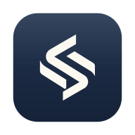

<p align="center"></p>

# Sovare HQ

Centro de control personal para un ecosistema de software y negocios: proyectos, finanzas, publicidad, desarrollo, tareas, actividad, alertas e IA — en una app local-first para macOS.

> **Regla fundamental:** nunca se muestran métricas inventadas. Un valor desconocido aparece como **“Sin datos”**, una fuente sin conectar como **“No conectada”**, un cero real como **0**, y una sincronización fallida avisa que los datos pueden estar desactualizados. Los datos de demostración viven en una **base separada** y la UI muestra un banner permanente.

## Qué incluye (v0.1)

| Sección | Funcionalidad real |
|---|---|
| **Overview** | 10 KPIs con drill-down y variación mensual, gráfico financiero configurable (Hoy/7/30/90 días/Año/Personalizado, por proyecto), *What needs your attention?*, *Daily Brief* desde la última visita, 3 prioridades del día, resumen de proyectos con búsqueda/filtros/orden, widgets reordenables/ocultables |
| **Projects** | CRUD, candidatos conocidos (GastroOS, CosovGO, Cerquita, FitNow, MEMO, PROFE, Casaca de Cancha, Reservas, Trading Bot, Sovare), **descubrimiento local** en carpetas autorizadas (Git, manifests, Dockerfiles, configs de deploy) con deduplicación local↔remoto, ficha con General/Tecnología/Desarrollo/Negocio/Operaciones/Roadmap/Scorecard, deep links (GitHub, Finder, VS Code, producción, admin), sugerencias de estado basadas en evidencia, menú contextual |
| **Finance** | Ingresos/gastos/comisiones/reembolsos/inversión en ARS y USD (moneda original), estado de resultados por moneda, flujo de caja, ROI, importación CSV idempotente y reversible, exportación CSV, comprobantes adjuntos, historial de auditoría, recurrentes/suscripciones, presupuestos, Financial Intelligence (break-even, burn rate, concentración, CAC), simulador de escenarios, tipos de cambio con fuente y fecha |
| **Analytics** | Plantillas SaaS / E-commerce / App móvil / Web + desarrollo, métricas con fuente/período/actualización, carga manual, consolidado por categoría |
| **Marketing** | Campañas (Meta Ads / CSV), gasto, impresiones, alcance, clics, CTR, CPC, CPM, conversiones, CPA, ROAS solo si es calculable, comparación de períodos, Ads AI Analyst basado en evidencia. Solo lectura |
| **Development** | Developer Timeline, repositorios (GitHub + locales), CI, despliegues (Vercel/Netlify), health checks con historial/latencia/disponibilidad, importación de issues como tareas |
| **AI Insights** | Motor local de recomendaciones (sin API paga), preguntas frecuentes respondidas con evidencia, asistente con herramientas tipadas (OpenAI / Anthropic / modelo local), Daily AI Brief, Weekly Business Review exportable a PDF, controles de privacidad por categoría |
| **Tasks & Roadmap** | Smart Priorities con criterios visibles y configurables, Kanban con drag & drop, calendario, roadmap por hitos, subtareas, etiquetas, dependencias, vencidas/hoy |
| **Activity** | Historial unificado con fuente, proyecto, tipo, fecha, ID externo y enlace; filtros |
| **Integrations** | Hub de conectores con estados Connected / Disconnected / Needs Setup / Syncing / Error / Unsupported, guía, permisos mínimos, prueba manual, sincronización, mapeo a proyectos, historial |
| **Settings** | Tema claro/oscuro/automático, moneda, sincronización, notificaciones, reglas de alertas, IA y privacidad, backup/restore verificable, exportación JSON, modo demo |
| **Global** | ⌘K command palette + búsqueda global, atajos, acciones rápidas, menú en la barra de macOS con resumen, notificaciones nativas, onboarding de 8 pasos |

## Inicio rápido

```bash
npm install
npm run dev            # versión web en http://localhost:1420 (adaptador navegador/PWA)
npm run tauri:dev      # app nativa (requiere Rust)
npm run check          # typecheck + lint + 207 tests
```

### Instalar en tu Mac

```bash
./scripts/build-mac.sh          # genera src-tauri/target/release/bundle/{macos/Sovare HQ.app, dmg/*.dmg}
./scripts/install-mac.sh        # copia la app a /Applications
```

O sin Mac de compilación: GitHub → Actions → **Build macOS app** → *Run workflow* → descargá el artefacto `.dmg` (build universal, sin firmar). Ver [docs/SETUP.md](docs/SETUP.md).

## Documentación

- [docs/SETUP.md](docs/SETUP.md) — guía breve de configuración e instalación
- [docs/INTEGRATIONS.md](docs/INTEGRATIONS.md) — cada integración: permisos, pasos, datos, limitaciones
- [docs/ARCHITECTURE.md](docs/ARCHITECTURE.md) — arquitectura, modelo de datos, definiciones financieras, seguridad
- [docs/LIMITATIONS.md](docs/LIMITATIONS.md) — registro honesto de limitaciones reales
- [docs/ROADMAP.md](docs/ROADMAP.md) — mejoras futuras
- [AGENTS.md](AGENTS.md) — reglas para futuras sesiones de agentes (Codex/Claude)

## Stack

Tauri 2 (Rust) · React 19 + TypeScript · Vite 7 · Tailwind CSS 4 · TanStack Query · Recharts · SQLite (rusqlite nativo / sql.js en navegador y tests) · Radix UI · cmdk · zod · Keychain de macOS.

## Marca

El isotipo de Sovare proviene del footer de gastroos.shop (`/marca/sovare-isotipo.webp`); se vectorizó a `assets/brand/sovare-isotipo.svg` y desde ahí `npm run icons` genera el ícono de la app (Dock, Finder, Spotlight), el ícono de la barra de menú, favicon/PWA y la marca de la UI.
